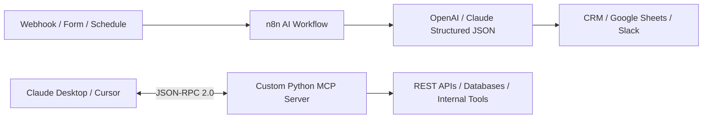

# AI Automation & MCP Server Starter Templates (n8n · Python MCP · Vibe-App Debug Kit)


Clean, modular open-source starter templates for **n8n AI automation workflows**, **Model Context Protocol (MCP) servers**, and **debugging AI-built (vibe-coded) web apps**.

> **Note:** All files in this repository are open-source **sample demo architectures** built for testing and learning—no client data or private keys are included.

---

## Architecture Overview



---

## Included Files

| File | Description |
|---|---|
| [`01_ai_lead_enrichment_crm_slack.json`](./01_ai_lead_enrichment_crm_slack.json) | n8n workflow: Inbound webhook → OpenAI JSON lead scoring → conditional routing → Slack & Google Sheets CRM. |
| [`02_ai_customer_support_triage_agent.json`](./02_ai_customer_support_triage_agent.json) | n8n workflow: Support ticket webhook → AI classification & draft reply → department queue switch. |
| [`03_scheduled_api_report_summarizer.json`](./03_scheduled_api_report_summarizer.json) | n8n workflow: Daily scheduled KPI digest generator. |
| [`sample_payloads.json`](./sample_payloads.json) | Sample anonymized webhook JSON payloads for testing the n8n workflows. |
| [`mcp_business_tools_server.py`](./mcp_business_tools_server.py) | Working Python JSON-RPC 2.0 MCP server (`3` verified sample tools for Claude Desktop & Cursor). |
| [`claude_desktop_config.sample.json`](./claude_desktop_config.sample.json) | Sample MCP client config for Claude Desktop / Cursor. |
| [`Dockerfile`](./Dockerfile) | Container image for running the Python MCP server. |
| [`env_security_audit.py`](./env_security_audit.py) | Pre-launch `.env` & hardcoded API key scanner for Cursor, Lovable, Bolt & Replit apps. |
| [`DEBUG_CHECKLIST.md`](./DEBUG_CHECKLIST.md) | Pre-launch debugging & security checklist for vibe-coded web apps. |

---

## Quick Start

```bash
# 1. Verify the Python MCP server
python mcp_business_tools_server.py --selftest

# 2. Run the pre-launch environment security audit
python env_security_audit.py .
```

---

## Need a Custom Workflow, MCP Server, or Code Fix?

All custom development, debugging, and orders are handled securely on **Fiverr**:

- **Build Custom n8n AI Workflows & Agents:** http://www.fiverr.com/s/kX89lGy
- **Build Custom MCP Servers (Claude / ChatGPT / Cursor):** http://www.fiverr.com/s/bk01Kpa
- **Fix, Debug & Optimize Existing n8n Workflows:** http://www.fiverr.com/s/p3wW378
- **Debug & Stabilize Vibe-Coded Apps (Cursor / Lovable / Bolt):** http://www.fiverr.com/s/kX8d25o
